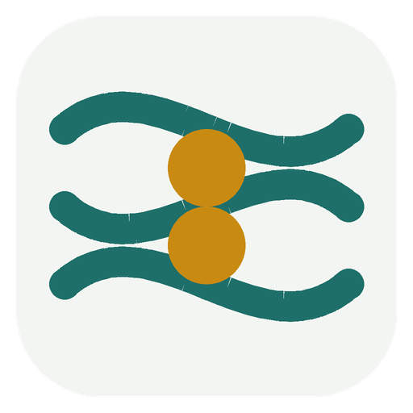

<p align="center"></p>

<h1 align="center">Citeweave</h1>

<p align="center">Free, open source literature discovery for researchers.<br>
Search open databases, map how papers connect, ask questions with sourced answers, and pull details from many papers into one table.</p>

---

Use it in your browser, or install it on Windows. There are no accounts, no credits and no subscriptions. It uses open scholarly data, and AI is optional: use a free local model, your own key for a cloud provider, the chatbot you already have, or no AI at all.

## What it does

**Search** across OpenAlex, Semantic Scholar, Crossref, Europe PMC, arXiv and PubMed, plus CORE and Scopus if you have keys. Paste a DOI, arXiv id, PubMed id or article link to open a paper directly. Filter by year, open access and sort order.

**Citation maps.** Pick one or more seed papers. Citeweave collects their references and the papers that cite them, then ranks every candidate by:

- direct citation links with the seeds
- bibliographic coupling (citing the same works)
- co-citation (being cited together by later papers)

Shown as a timeline (year against citations) or a network. Each map also lists the field's **foundations** (older papers most of the map cites) and **newer work** (papers citing much of the map, often reviews). Save a map and check it later for new papers citing your seeds.

**Ask a question.** Citeweave finds and ranks the most relevant papers, then writes a short answer that cites each claim with a link to its paper. With AI off, it shows the key sentence from each abstract, and you can get a written answer from your own chatbot. Questions and answers are kept in your history.

**Tables.** Choose papers and describe columns, such as method, sample size, location, key findings or limitations. The AI fills each cell from the abstract, or from the full text when a legal open access PDF exists, and adds a supporting quote. No AI key? Fill it with your own chatbot instead. Citeweave checks every quote against the paper and marks what it cannot confirm. Export to CSV for Excel.

**Smart ranking.** An optional small model (about 25 MB) runs on your computer and ranks results by meaning, not only by matching words. No key needed.

**Sync and backup.** Keep the same library on every device through your own GitHub, Google Drive, OneDrive or a synced folder, optionally locked with a passphrase.

**Library.** Collections, reading status, notes and tags. Import BibTeX, RIS or a list of DOIs. Export BibTeX, RIS or CSV. You can also send papers to Zotero or import from it. Similar-paper suggestions are available for any collection.

**Researcher profiles.** Load anyone's works from an ORCID iD, OpenAlex author id, Semantic Scholar author id or Scopus author id, with total citations, h-index and i10-index.

**Browser extension** for Chrome, Edge, Brave and Firefox. On any journal page, click the Citeweave button to save the paper, open it in the app or add it to your map.

## Use it in your browser

Open the web version (the address is on this project's GitHub page once it is published) and start searching. Nothing to install. Your library is kept in your browser; turn on sync or download a backup to keep it safe. To host your own copy for free on GitHub Pages, see [web/README.md](web/README.md).

## Install on Windows

### Option 1: ready-made app

1. Download `Citeweave-windows.zip` from the [Releases](../../releases) page.
2. Unzip it anywhere, for example into `Documents`.
3. Double-click `Citeweave.exe`.

If Windows SmartScreen warns you, choose **More info**, then **Run anyway**. The warning appears because the app is new and unsigned.

### Option 2: run from source

1. Install [Python 3.10 or newer](https://www.python.org/downloads/) and tick **Add python.exe to PATH**.
2. Download this repository (**Code**, **Download ZIP**) and unzip it.
3. Double-click **`Start Citeweave.bat`**. The first start installs what it needs, which takes about a minute. Later starts are instant.

To build the `.exe` yourself, run `build_windows.bat`.

## Install the browser extension

Download the extension zips from [Releases](../../releases), or build them with `python scripts/build_extension.py`.

**Chrome, Edge, Brave or Opera**
1. Unzip `citeweave-extension-chromium.zip`.
2. Open `chrome://extensions` (or `edge://extensions`) and turn on **Developer mode**.
3. Click **Load unpacked** and choose the unzipped folder.

**Firefox**
1. Open `about:debugging#/runtime/this-firefox`.
2. Click **Load Temporary Add-on** and choose `citeweave-extension-firefox.zip`.

For a permanent Firefox install, the extension needs to be signed through addons.mozilla.org.

By default the extension talks only to the Citeweave app on your own computer (`http://127.0.0.1:23120`), so keep the app open while you use it. To use it with the web version instead, open the extension's options, choose **The Citeweave web version** and paste the web address. Shortcut: **Alt+Shift+C**.

## AI, all optional

Pick a provider in **Settings, AI**:

| Provider | Cost | Notes |
|---|---|---|
| Built-in browser AI | Free | Web version only, in recent desktop Chrome on capable computers |
| Ollama | Free | Runs on your computer. Install from [ollama.com](https://ollama.com), then `ollama pull llama3.2` (or `qwen2.5:7b` for better quality) |
| LM Studio or any OpenAI-compatible server | Free | Choose **Custom** and enter the server address |
| OpenAI (ChatGPT) | Your key | |
| Anthropic (Claude) | Your key | |
| Google Gemini | Your key | Has a free tier |
| DeepSeek | Your key | Low cost |
| Groq | Your key | Has a free tier, very fast |
| Mistral | Your key | |
| OpenRouter | Your key | Hundreds of models with one key |

Use **Load models** to list the models your key can use, and **Test connection** to check the setup.

**No AI key? Use your chatbot.** On the Ask and Tables pages, and in Search ("Ask my chatbot for papers"), Citeweave writes a ready prompt with the papers' abstracts. Paste it into ChatGPT, Claude, Gemini, DeepSeek or Copilot, then paste the reply back. Citeweave checks the citation numbers, the quotes and any suggested papers against the real records, and marks or drops what does not match. This uses your existing chatbot account the normal way, by hand, so it stays within each service's terms.

**AI suggestions as a search source.** If you prefer, choose "AI suggestions (verified)" in Search. The AI proposes papers, and Citeweave checks every one against Crossref and OpenAlex. Anything that cannot be found is dropped, so invented references never reach your library.

## Use Citeweave from Claude

If you have a Claude subscription, the Claude desktop app can use Citeweave as a set of tools. You ask in Claude, for example "find recent papers on recycled coarse aggregate and make a table of methods and findings in my RCA collection", and Claude searches the open databases, reads the papers and saves the table into Citeweave. The AI work runs on your own Claude plan, so Citeweave needs no AI key for this.

Claude can search papers, open a paper with its references and citations, list and read your collections, save papers to a collection, build a citation map, save a table (shown on the Tables page), save an answer to your question history, and export BibTeX.

1. In the Claude desktop app open **Settings, Developer, Edit Config**. This opens `claude_desktop_config.json`.
2. Add Citeweave and save the file.

   With the ready-made app (change the path to where you unzipped Citeweave):

   ```json
   {
     "mcpServers": {
       "citeweave": {
         "command": "C:\\Users\\YOU\\Citeweave\\citeweave-mcp.exe"
       }
     }
   }
   ```

   When running from source:

   ```json
   {
     "mcpServers": {
       "citeweave": {
         "command": "C:\\path\\to\\Citeweave\\.venv\\Scripts\\python.exe",
         "args": ["-m", "citeweave.mcp_server"],
         "cwd": "C:\\path\\to\\Citeweave"
       }
     }
   }
   ```

3. Restart Claude. Citeweave appears in the tools menu.

The tools use the same library as the Citeweave window, and they work even when the window is closed.

## Sync your library

**Settings, Sync and backup** keeps your library, notes, tags, maps, tables and question history in one file that the PC app and the web version can both use. Your API keys are never part of it, and you can protect the file with a passphrase.

- **Folder:** choose a folder, for example one that Google Drive or OneDrive already syncs on your PC. No sign-in needed. In the web version this works in Chrome and Edge.
- **GitHub:** a private repository. Create a fine-grained token at github.com/settings/tokens with access to that one repository and **Contents: Read and write**, then paste it with the repository name (for example `your-name/citeweave-data`). Every sync is saved as a version you can go back to.
- **Google Drive or OneDrive sign-in:** web version only, when the site owner has added a free app id (see [web/README.md](web/README.md)).
- **Backup file:** download a backup at any time and restore it on any device.

When the same item was changed on two devices, the newer change wins for that item only.

## Data sources and limits

Everything works without keys. Free keys raise the limits:

| Source | Without key | With free key |
|---|---|---|
| OpenAlex | Small daily allowance; lookups by DOI are free | 10x the allowance ([get key](https://openalex.org/settings/api)) |
| Semantic Scholar | Shared public pool, can be busy | Steady personal rate ([request key](https://www.semanticscholar.org/product/api)) |
| Crossref, OpenCitations, Europe PMC, arXiv, PubMed, Unpaywall, ORCID | Free | Not needed |
| CORE | Needs a free key | [core.ac.uk](https://core.ac.uk/services/api) |
| Scopus | Needs your own key and usually your institution's network | [dev.elsevier.com](https://dev.elsevier.com) |

Add your email in **Settings, General**. Crossref, OpenAlex and PubMed then give you faster, more reliable access, and Unpaywall can find open access PDFs.

Citeweave is light on resources. It caches every response in a local database, so repeat lookups cost nothing. It spaces out its requests so it never strains these free services. When one source is busy or out of allowance, it moves to the next.

## Your data

Everything is stored in `%APPDATA%\Citeweave`: your library, notes, maps, tables, settings and cache. It is a single SQLite database plus a settings file. Your API keys are kept there too, and each one is only sent to the service it belongs to.

## For developers

```
python -m venv .venv
.venv\Scripts\activate
pip install -r requirements-dev.txt
python -m citeweave            # app window
python -m citeweave --browser  # open in your browser instead
python -m pytest
```

- [docs/DESIGN.md](docs/DESIGN.md) covers architecture, folder structure, data model and algorithms.
- [docs/RESEARCH.md](docs/RESEARCH.md) explains the features researchers need and how each is built from open data.
- [CONTRIBUTING.md](CONTRIBUTING.md) covers adding a data source or AI provider.

## Acknowledgements

Citeweave exists because these organisations make scholarly metadata open:

- OpenAlex (OurResearch, CC0)
- Crossref
- OpenCitations (CC0)
- Semantic Scholar (Allen Institute for AI)
- Europe PMC
- PubMed (NCBI)
- arXiv. Thank you to arXiv for use of its open access interoperability.
- Unpaywall
- ORCID
- CORE

Please respect each provider's terms of use.

## License

MIT. Free to use, change and share.
